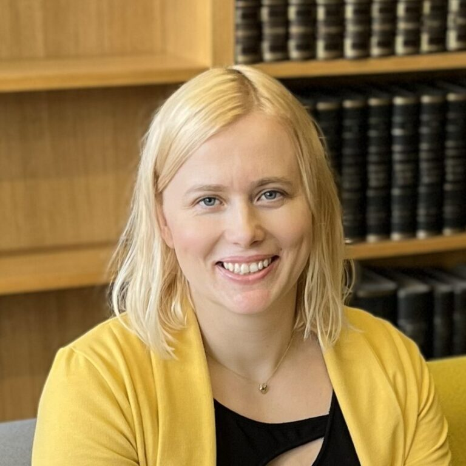
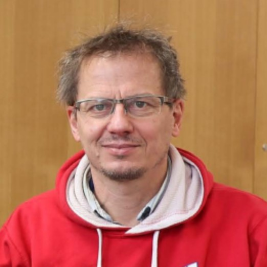
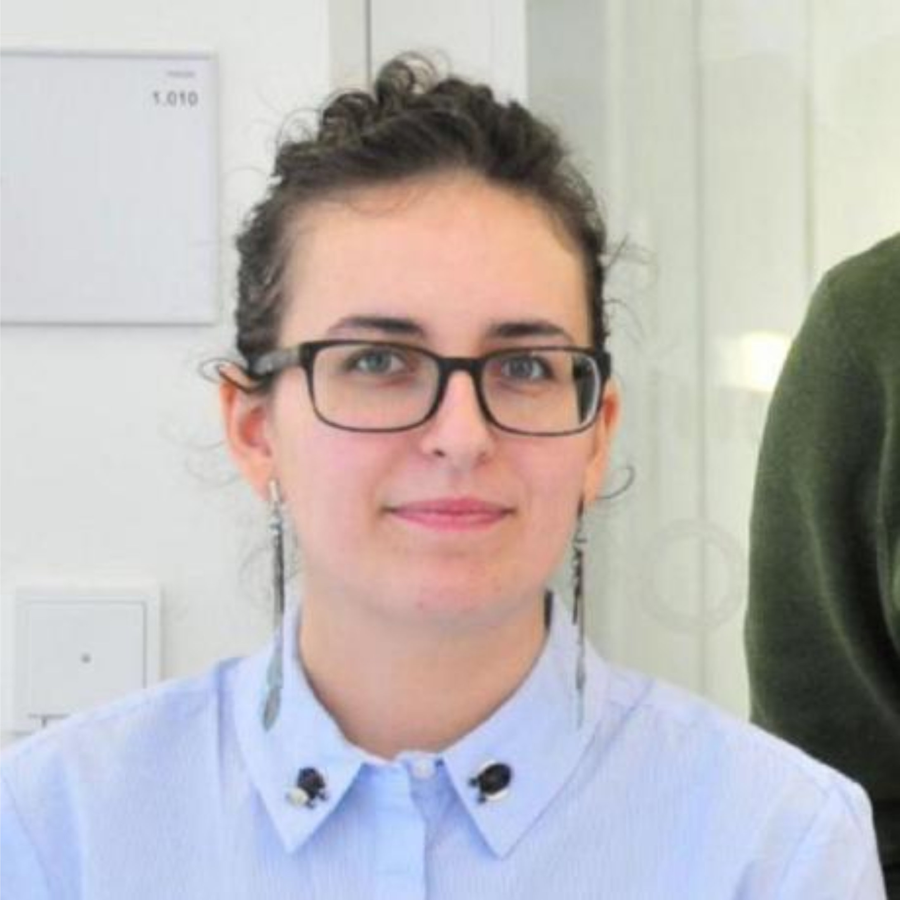
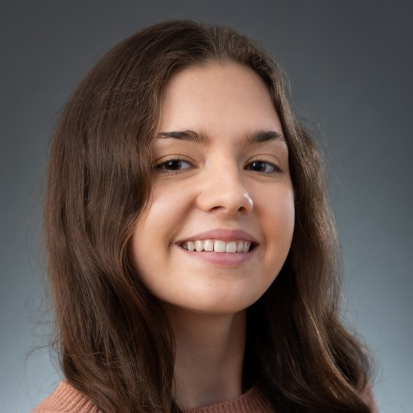
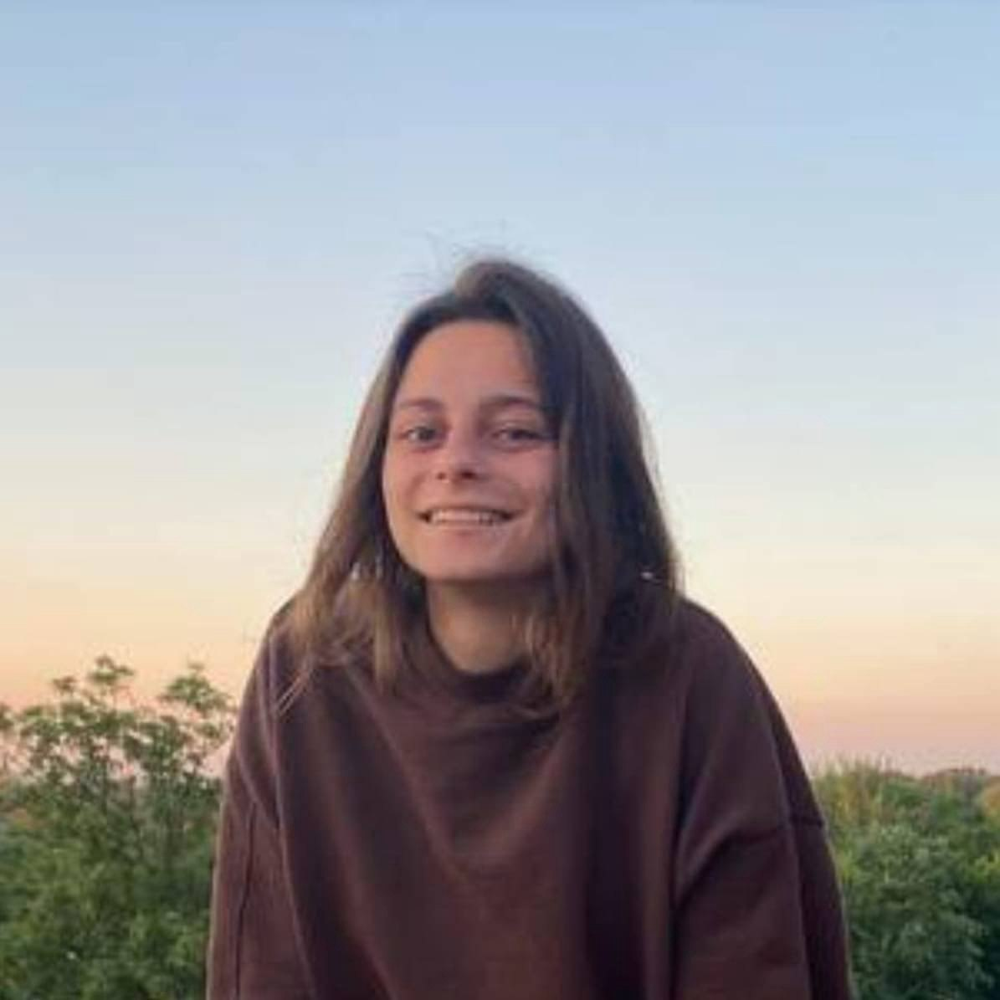

# Bioinformatics@FI

**[Technologies](#technologies--approaches) · [Tools](#our-tools) · [Research](#current-research-interests) · [Publications](#recent-publications) · [Teaching](#teaching) · [Members](#lab-members) · [Contact](#get-in-touch)**

---

### **Sequence Bioinformatics & Genomics Group** at the **Faculty of Informatics, Masaryk University** (Brno, Czech Republic).

We analyze genomes of humans, plants and other model organisms using long-read sequencing, focusing on complex
and repetitive regions such as centromeres, telomeres, ribosomal DNA and the Y chromosome, DNA methylation and
secondary DNA structures. We develop bioinformatics tools for these challenging regions.

**Looking for our software? Start with [Our tools](#our-tools) below.**  
**Interested in collaboration or a thesis topic? [Get in touch](#get-in-touch).**

---

## Technologies & approaches

We work primarily with **Oxford Nanopore Technologies (ONT)** and other **long-read sequencing** data, and we
keep up with the latest sequencing technologies and methods.

- **Oxford Nanopore & long reads**: ultra-long ONT reads and other long-read data for whole-genome
  assemblies, including complete telomere-to-telomere assemblies of complex and repetitive regions, together
  with direct methylation calling.
- **Pangenomes**: human and other pangenomes to study genome variation, including complex and repetitive
  regions, across many individuals.
- **Basecalling**: basecalling of raw nanopore signal data, including
  hyperbasecalling (an experimental model for ONT's [Dorado](https://github.com/nanoporetech/dorado) basecaller).
- **Diverse sequencing assays**: analysis of a wide range of sequencing data, including specialized methods
  such as **PDAL-seq** and its ONT-based version.

---

## Our tools

Bioinformatics tools from our lab, built for long-read data and complex, repetitive regions of the genome.
Many of them were created as part of students' bachelor's and master's thesis projects at FI MU,
and all are designed to be **easy to install and use**.

#### Recently developed tools

| Tool | What it does |
|---|---|
| [**andro**](https://pypi.org/project/andro/) | Fast annotation of the internal structure of rDNA arrays in genome assemblies, with partial support for nanopore reads. |
| [**bafiq**](https://ceur-ws.org/Vol-4092/paper27.pdf) | Flag-based BAM index (Rust) for much faster repeated counting and filtering of reads by FLAG combinations. |
| [**bambam**](https://github.com/patrikjurica/bambam) | Filters alignments by shared rare k-mers to keep only reads confidently anchored in repetitive regions such as rDNA. |
| [**epidotplot**](https://github.com/xhabararb/epidotplot) | DNA sequence dotplots (self or pairwise) with an overlay of cytosine methylation. |
| [**raaqa**](https://github.com/kuzsam/raaqa) | Assembly quality assessment from read alignments (MAPQ, soft-clipping) and haplotype separation in trio-based hifiasm assemblies. |
| [**straln**](https://github.com/nikolienka24/straln) | Converts EMBOSS stretcher alignments to BED/BEDPE and finds misplaced variants in repetitive regions, with automated IGV snapshots. |

#### Established tools

| Tool | What it does |
|---|---|
| [**pqsfinder**](https://pqsfinder.fi.muni.cz/) | Imperfection-tolerant prediction of G-quadruplex-forming sequences, also available as a [Bioconductor package](https://bioconductor.org/packages/pqsfinder/). |
| [**triplex**](https://bioconductor.org/packages/triplex/) | Search and 1D/2D/3D visualization of potential intramolecular triplex-forming sequences (H-DNA) in DNA ([paper](https://doi.org/10.1093/bioinformatics/btt299)). |

---

## Current research interests

### Ribosomal DNA (rDNA)

Ribosomal DNA arrays are the last unresolved region of human telomere-to-telomere assemblies. We develop
sequencing and assembly strategies to resolve them and reconstructed a complete rDNA array on chromosome 14.

Read more

Ribosomal DNA arrays are made of more than 100 copies of a ~45 kb unit. We combine high-coverage ONT sequencing,
including adaptive sampling, with the experimental hyperbasecalling model and optimized HiFiASM assembly
strategies, and analyze sequence variation across the assembled array.

**Repository:** [bioinf-fi/rDNA](https://github.com/bioinf-fi/rDNA) · **Preprint:** [bioRxiv, 2025](https://www.biorxiv.org/content/10.64898/2025.12.14.693655v1)

### Y chromosome methylation

We study variation in DNA methylation across 142 human Y chromosomes, with a focus on palindromic regions.

Read more

We characterize variation in DNA methylation levels and heterogeneity, with a focus on palindromic regions,
structural architecture and sequence-derived features such as G-quadruplexes. These patterns are related to
intra-palindromic sequence identity and the structural organization of the Y chromosome, using assemblies and
data from HPRC, HGSVC, GIAB and CEPH.

**Repository:** [bioinf-fi/Y-meth-pangenome](https://github.com/bioinf-fi/Y-meth-pangenome) · **Preprint:** [bioRxiv, 2026](https://doi.org/10.64898/2026.06.03.729890)

### Centromere dip regions (CDR)

Centromere dip regions are short hypomethylated regions that mark the site of kinetochore assembly. We study
how their position varies between individuals and how it is inherited.

**Preprint:** [bioRxiv, 2025](https://www.biorxiv.org/content/10.64898/2025.12.14.693655v1)

### G-quadruplex (G4) structures

G-quadruplexes are stable secondary DNA structures that can influence replication, mutation and recombination.
We study them genome-wide and across generations.

Read more

We focus on how G4-forming sequences mutate in a three-generation pedigree with complete genomes. We also
combine computational G4 prediction (e.g. with [pqsfinder](https://pqsfinder.fi.muni.cz/)) with experimental
G4 detection by PDAL-seq.

#### ↳ PRDM9 and G4

In a collaborative study, we showed that PRDM9, which determines the sites of meiotic recombination, directly
binds G4-forming DNA.

Read more

PRDM9 is a histone methyltransferase that determines the sites of meiotic recombination. We showed that G4 motifs
are among the most common features at PRDM9 binding sites, with the strongest enrichment for highly stable G4s,
and that PRDM9 directly binds G4-forming DNA. This suggests that stable G4 structures help recruit PRDM9 and may
contribute to the initiation of meiotic recombination.

**Repositories:** [tommsko/PRDM9-enrichment](https://github.com/tommsko/PRDM9-enrichment) · [angelikaLahn/PRDM9_G4_overlap](https://github.com/angelikaLahn/PRDM9_G4_overlap) · **Preprint:** [bioRxiv, 2026](https://www.biorxiv.org/content/10.64898/2026.07.31.742039v1)

---

## Recent publications

- Cechova M, et al. **Complete genomes of a multi-generational pedigree to expand studies of genetic and epigenetic inheritance.** *bioRxiv* (2025). [doi:10.64898/2025.12.14.693655](https://www.biorxiv.org/content/10.64898/2025.12.14.693655v1)
- Hallast P, et al. **Population-scale Y chromosome assemblies reveal recurrent remodeling within constrained architectures.** *bioRxiv* (2026). [doi:10.64898/2026.06.03.729890](https://doi.org/10.64898/2026.06.03.729890)
- Hartge MK, et al. **G-quadruplex structures act as a novel recognition motif for the meiosis-specific histone methyltransferase PRDM9.** *bioRxiv* (2026). [doi:10.64898/2026.07.31.742039](https://www.biorxiv.org/content/10.64898/2026.07.31.742039v1)
- Hon J, Martínek T, Zendulka J, Lexa M. **pqsfinder: an exhaustive and imperfection-tolerant search tool for potential quadruplex-forming sequences in R.** *Bioinformatics* 33(21):3373–3379 (2017). [doi:10.1093/bioinformatics/btx413](https://doi.org/10.1093/bioinformatics/btx413)
- Kotrs J, Lexa M. **bafiq: BAM Flag Index Tool for Faster Repeated Queries of Mapped Reads.** *ITAT 2025, CEUR Workshop Proceedings* Vol-4092 (2025). [PDF](https://ceur-ws.org/Vol-4092/paper27.pdf)

---

## Teaching

### University courses

Courses taught by our lab members at Masaryk University (FI = Faculty of Informatics, PřF = Faculty of Science).

| Code | Course | Semester |
|---|---|---|
| FI:IB031 | Introduction to Machine Learning | Spring |
| FI:IV107 | Bioinformatics of Sequences and Genomes | Autumn |
| FI:IV108 | Advanced Bioinformatics Algorithms | Spring |
| FI:IV110 | Exercises in Sequence Analysis | Autumn |
| FI:IV114 | Bioinformatics Practical | Spring |
| FI:IV129 | Lab Project – Sybila | Autumn, Spring |
| FI:PA052 | Introduction to Systems Biology | Autumn |
| FI:PA055 | Visualization of Bioinformatics Data | Autumn |
| FI:PB051 | Computational Methods in Bioinformatics and Systems Biology | Spring |
| FI:PB172 | Lab Seminar – Sybila | Autumn, Spring |
| FI:PV269 | Advanced Methods in Bioinformatics | Autumn |
| PřF:C4755 | Bioinformatics Seminar | Autumn |
| PřF:E4014 | Project in Mathematical Biology and Biomedicine – Biomedical Bioinformatics | Autumn |
| PřF:S5050 | Field Seminar – Life Sciences | Spring |

### For researchers

Hands-on bioinformatics workshops on analyzing modern genomics data, open to the broad scientific community,
including non-academics. Past topics include:

- [**Genome assembly**](https://www.fi.muni.cz/app/news?feed_id=title&archive=1&id=3933): telomere-to-telomere
  assembly, diploid genomes, assembly quality control and haplotype-resolved assemblies
  ([materials](https://github.com/bioinf-fi/workshops/tree/main/assembly))
- **Methylation analysis using long reads**: visualizing and calling methylation, MM/ML tags in nanopore reads,
  methylation-based read phasing and differential methylation analysis ([materials](https://github.com/bioinf-fi/workshops/tree/main/nanopore))

### For high school students

We take part in events for talented high school students, such as [**AI for Talents**](https://www.fi.muni.cz/admission/ai4talents.html.en),
[**Czech Hopes**](https://czechopes.cz/), [**BrNoc**](https://brnoc.cz/) and
other activities in Brno, introducing them to bioinformatics and genomics.

> Materials and Jupyter notebooks for all past workshops are available in [bioinf-fi/workshops](https://github.com/bioinf-fi/workshops).

---

## Lab members

<!--
  To add yourself: copy the template cell below into the table (into the last row if it has fewer than three
  cells, otherwise into a new <tr> ... </tr> row) and fill in your details.

    <td align="center" width="33%">
       
      <b>Name Surname</b> 
      Role 
      <a href="https://orcid.org/ID">ORCID</a> · <a href="https://github.com/USERNAME">GitHub</a> · <a href="https://www.linkedin.com/in/ID">LinkedIn</a>
    </td>

  - Photo: upload a square photo to profile/photos/ in the bioinf-fi/.github repository (e.g. jan-novak.jpg)
    and replace placeholder.png in the URL with your file name (keep placeholder.png if you have no photo). Keep the full raw.githubusercontent.com URL:
    relative paths do not work reliably on the organization page.
  - Links: keep only the ones you want (GitHub, Google Scholar, ORCID, personal website, ...).
  - Three people per row: when a row is full, start a new <tr> ... </tr> with up to three <td> cells.
  - The invisible spacer.png images in the first row stretch the table to the full page width
    (GitHub ignores width on tables and cells). Adjust width="245" there if needed.
-->

<table>
  <tr>
    <td align="center" width="33%">
       
      <b>Mgr. Monika Čechová, Ph.D.</b> 
      Assistant Professor 
      <a href="https://orcid.org/0000-0002-7420-2663">ORCID</a> · <a href="https://github.com/biomonika">GitHub</a> · <a href="https://scholar.google.com/citations?user=eRi4gvUAAAAJ">Google Scholar</a> 
      
    </td>
    <td align="center" width="33%">
       
      <b>doc. Ing. Matej Lexa, Ph.D.</b> 
      Associate Professor 
      <a href="https://orcid.org/0000-0002-4213-5259">ORCID</a> · <a href="https://www.researchgate.net/profile/Matej-Lexa">ResearchGate</a> 
      
    </td>
    <td align="center" width="33%">
       
      <b>Mariateresa Mazzetto, PhD</b> 
      Senior PostDoc Specialist 
      <a href="https://github.com/Mariateresa91">GitHub</a> · <a href="https://scholar.google.com/citations?user=Rsq2_MYAAAAJ">Google Scholar</a> · <a href="https://www.linkedin.com/in/mariateresa-mazzetto-880874138/">LinkedIn</a> 
      
    </td>
  </tr>
  <tr>
    <td align="center" width="33%">
       
      <b>Bc. Nikol Poláková</b> 
      Research Specialist 
      <a href="https://orcid.org/0009-0001-7001-3486">ORCID</a> · <a href="https://github.com/nikolienka24">GitHub</a> · <a href="https://www.linkedin.com/in/nikol-pol%C3%A1kov%C3%A1-518aa1388/">LinkedIn</a>
    </td>
    <td align="center" width="33%">
       
      <b>Bc. Tomáš Pavlík</b> 
      Analyst 
      <a href="https://github.com/tommsko">GitHub</a>
    </td>
    <td align="center" width="33%">
       
      <b>Bc. Nadzeya Antsipenka</b> 
      Research Specialist 
      <a href="https://github.com/Unhappybee">GitHub</a> · <a href="https://www.linkedin.com/in/nadzeya-antsipenka-079539398/">LinkedIn</a>
    </td>
  </tr>
</table>

---

## Get in touch

- [Faculty of Informatics, Masaryk University](https://www.fi.muni.cz/)
- [Systems Biology and Bioinformatics Laboratory (SYBILA)](https://www.fi.muni.cz/research/laboratories/sybila.html.en)
- [Bioinformatics at Masaryk University: research and projects](https://bioinformatika.muni.cz/vyzkum-a-projekty)
- Contact:
  - Mgr. Monika Čechová, Ph.D. ([cechova@fi.muni.cz](mailto:cechova@fi.muni.cz))
  - doc. Ing. Matej Lexa, Ph.D. ([lexa@fi.muni.cz](mailto:lexa@fi.muni.cz))
